<div align="center">
  
</div>

<br/>

<p align="center">
  <a href="https://doi.org/10.5281/zenodo.24125244">
    
  </a>
  <a href="https://www.linkedin.com/in/kunal-garg-b48665221/">
    
  </a>
  <a href="mailto:kunalgarg1001@gmail.com">
    
  </a>
</p>

---

<table>
<tr>
<td width="58%" valign="top">

### 🚀 About Me

I'm passionate about diving into complex, mind-bending problems—whether that's architecting production deep learning models and debugging byte-level serialization pipelines, or figuring out the lore of *Dark* and *Severance*.

- 🎓 **Education:** B.Tech in **Artificial Intelligence & Data Science** at Bikaner Technical University (**8.26 CGPA** | **8.95 Peak SGPA**).
- 📄 **Published Research:** 1st-Author Indexed Preprint on **CERN / Zenodo & OpenAIRE** ([DOI: 10.5281/zenodo.24125244](https://doi.org/10.5281/zenodo.24125244)).
- 🏆 **Olympiads & Scientific Distinctions:**
  - **UrFU *Izumrud.Student* Olympiad:** Scored **70/100** in *Engineering & Computer Science* (Proctored Qualifier).
  - **3x Stepik Distinctions (*С отличием*):** *Bioinformatics Institute (St. Petersburg)* & *Samsung Research Russia (AI Center Moscow)*.
  - **RANEPA & Ministry of Culture Dictation:** **30/30** (in Cyrillic).
- 💻 **Experience:** Internships in AI & Full-Stack Web Development + STEM Educator (Math & Physics).
- 🌍 **Languages:** Code (`Python`, `SQL`, `JS`) & Spoken (learning **Russian / Русский**, **French & Italian**!).
- ⚡ **Off-Keyboard:** Grinding *Elden Ring* or *Kingdom Come: Deliverance II*, watching *One Piece*, or tuning into Hip-Hop.

</td>
<td width="42%" valign="top">

### 🖥️ Live Console | О себе (RU)

```yaml
user: "Kunal Garg (Гарг Кунал)"
role: "AI & Computer Vision Researcher"
degree: "B.Tech AI & Data Science (8.26 CGPA)"
publication_doi: "10.5281/zenodo.24125244"
olympiad_urfu: "70/100 (Engineering & CS)"
russian_certs:
  - "Bioinformatics Inst: Stats (С отличием)"
  - "Bioinformatics Inst: DS/ML (С отличием)"
  - "Samsung AI Russia: CV/DL (С отличием)"
status: ">_ Ready for Master's AI Research"
```

**🇷🇺 Краткое резюме:**
Исследователь в области искусственного интеллекта и компьютерного зрения, инженер промышленных ML-систем (`PyTorch`, `FastAI`, `Scikit-Learn`, `FastAPI`, `Docker`). Автор научной работы в CERN/Zenodo ([10.5281/zenodo.24125244](https://doi.org/10.5281/zenodo.24125244)) с аннотацией на русском языке.

</td>
</tr>
</table>

---

### 🧠 Production AI Systems & Published Research | Промышленные ИИ-системы

| System & Repository | Live Deployment | Architecture & Empirical Highlights |
| :--- | :--- | :--- |
| 🌱 **[AgriSense AI](https://github.com/kunal-garg-1/Agri-Sense-AI)**<br>*(Dual-Engine CV + Econometrics)* | [🔗 **Live Streamlit App**](https://agri-sense-ai-tool.streamlit.app/)<br>[📄 **CERN DOI Paper**](https://doi.org/10.5281/zenodo.24125244) | • **Vision (`ResNet-18` / FastAI):** 2-stage discriminative fine-tuning across 15 PlantVillage classes ($128 \times 128$); **99.95% accuracy**, **0.9996 Macro F1** ($\mathcal{L}_{\text{valid}}: 0.195251 \rightarrow 0.001528$ in `9m 54s` on T4 GPU).<br>• **Pricing (`Random Forest`, 100 Trees):** Leakage-free econometric model ($N = 2,794$, $D = 17$ one-hot features); **$R^2 = 0.7200$**, **$\text{RMSE} = 2,659.49\text{ INR}$**.<br>• **MLOps:** Pure PyTorch `state_dict` (`disease_weights.pth`) + `model_columns.pkl` schema pinning. |
| 🏠 **[Île-de-France Housing Engine](https://github.com/kunal-garg-1/French-Housing-Engine)**<br>*(Dockerized FastAPI Microservice)* | [🔗 **Live Render API**](https://french-housing-engine.onrender.com/) | • **Stack:** `FastAPI`, `Uvicorn`, `Docker`, `Scikit-Learn`, `Tailwind CSS`.<br>• **97.8% Payload Compression:** Pruned ensemble (`max_depth=12`, `n_estimators=50`) from **`233 MB → ~5 MB`** (`idf_real_estate_model.pkl`), bypassing Git LFS limits while preserving $R^2$.<br>• **Hardening:** `.dockerignore` OOM shielding + multi-stage Docker layer caching. |
| 🍷 **[Deep-Bordeaux Wine Predictor](https://github.com/kunal-garg-1/Bordeaux_wine_predictor)**<br>*(Custom PyTorch MLP Regression)* | [🔗 **Live Streamlit App**](https://bordeauxwinepredictor.streamlit.app/) | • **Topology:** Custom `PyTorch` Multi-Layer Perceptron (`11 → 64 ReLU → 32 ReLU → 1`) over 11 physicochemical features.<br>• **Inference:** `Adam (lr=0.001)` + `MSELoss` with persisted `StandardScaler` (`scaler.pkl`) and `torch.no_grad()` `float32` tensor execution. |
| 🎨 **[The AI Curator: Art Classifier](https://github.com/kunal-garg-1/French_Art_Classifier)**<br>*(Deep CNN Brushstroke Classifier)* | [🔗 **Live Streamlit App**](https://french-art-curator.streamlit.app/) | • **Pipeline:** Automated web scraping (`bing-image-downloader`) + `ImageClassifierCleaner` curation across 4 French Masters (*Monet, Renoir, Degas, Cézanne*).<br>• **Python 3.13 PyTorch Bypass:** Raw `ResNet-18` `model.eval()` weights + custom `torchvision.transforms` and `softmax` pipeline. |

---

### 🛠️ Tech Stack & Arsenal

<div align="center">

  
  
  
  
  
  
  <br/>
  
  
  
  
  
  
  
  

</div>

---

### 📖 Citation (CERN / Zenodo DOI)

```bibtex
@article{garg2026agrisense,
  author    = {Garg, Kunal},
  title     = {AgriSense AI: An Integrated Dual-Engine Deep Transfer Learning and Ensemble Regression Framework for Crop Foliar Disease Diagnosis and Agricultural Commodity Price Forecasting},
  journal   = {Zenodo (CERN) / OpenAIRE},
  year      = {2026},
  month     = nov,
  doi       = {10.5281/zenodo.24125244},
  url       = {[https://doi.org/10.5281/zenodo.24125244](https://doi.org/10.5281/zenodo.24125244)}
}
```

---

<div align="center">

### My Neural Network Brain



</div>

---

<div align="center">

### 🐍 Contribution Graph Snake

<picture>
  <source media="(prefers-color-scheme: dark)" srcset="https://raw.githubusercontent.com/kunal-garg-1/kunal-garg-1/output/github-contribution-grid-snake-dark.svg" />
  <source media="(prefers-color-scheme: light)" srcset="https://raw.githubusercontent.com/kunal-garg-1/kunal-garg-1/output/github-contribution-grid-snake.svg" />
  
</picture>

</div>
